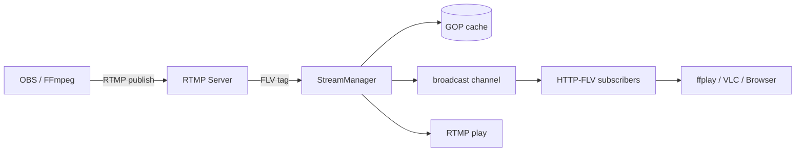
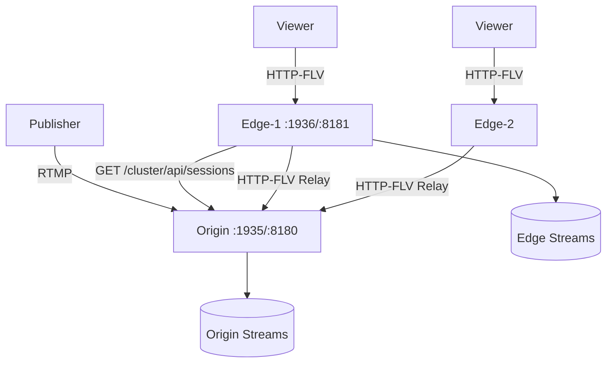

# m7s-rs — Rust 流媒体服务器（Monibuca 对标子集）

`m7s-rs` 是一个 Rust 实现的流媒体服务器参考工程，对标 Monibuca 的核心链路：

- **RTMP** 推流（OBS / FFmpeg）
- **HTTP-FLV** 拉流
- **Origin / Edge 集群**：控制面 API、会话目录、Edge 按需回源、HTTP-FLV Relay
- **GOP 缓存 + 广播分发**
- **HTTP API**：流列表、健康检查、集群状态/会话/Relay
- **单元测试 + 真实 TCP 集成测试**

> **状态：v0.1.0 release candidate（2026-11-26）。** 已交付 RTMP/HTTP-FLV、HLS TS/fMP4/LL-HLS/AES、RTSP TCP/UDP/Digest、SRT、WHEP/WHIP、WebTransport、GB28181 信令、ONVIF、QUIC 集群/故障切换、gRPC TLS/token、SQLite 迁移、Room/Live/Meeting、Admin RBAC/审计、Web SDK 重连/ABR、WASM 市场/热更新、原生 SEI/Mix/scale、告警、Edition 授权；10K 并发已验证。完整矩阵见 [ACCEPTANCE_MATRIX.md](docs/ACCEPTANCE_MATRIX.md)，差异见 [V6_DIFF_2026-11-18.md](docs/V6_DIFF_2026-11-18.md)，交付见 [DELIVERY.md](docs/DELIVERY.md)。
>
> Release candidate：构建/测试/CI/交付文档已准备；第三方 Chrome/VLC 二进制、`tools/` 运行时文件不进入仓库；测试证书仅为 fixtures。

> 本项目是 **清洁室参考实现**，只依据 Monibuca 公开文档与产品行为进行设计，没有复制 Monibuca v6 闭源代码。Monibuca v5 是 AGPL 的 Go 项目，v6 为闭源 Rust 商业产品；本工程使用独立 MIT 许可。

## 1. 调研结论

### Monibuca 产品能力

根据官网文档（[monibuca.com](https://monibuca.com)）与 Gitee v5 源码（[m7s/monibuca](https://gitee.com/m7s/monibuca)）：

- v6 为 Rust 重写、闭源、预编译分发；核心是零拷贝 RingBuffer、Dispatcher 单读广播、插件化协议。
- 协议：RTMP、RTSP、HTTP-FLV、HLS、WebRTC（WHIP/WHEP）、SRT、GB28181、WebTransport。
- WHEP：`POST /whep/<app>/<name>`（默认端口 8081），请求体为 SDP offer，返回 SDP answer；H.264 以 Annex B 写入 WebRTC track。
- 集群：Origin-Edge，节点间 QUIC Relay；HTTP 控制面负责心跳、节点/会话目录、分配与重定向；故障状态 Healthy/Suspect/Offline。
- 功能：录制、截图、转码、房间/会议、鉴权、监控、Admin、Web SDK。
- v5 源码结构：`pkg/` 基础库、`plugin/` 协议与功能插件、`publisher.go`/`subscriber.go`/`stream` 管理。

### 本实现取舍

| 能力 | Monibuca v6 | m7s-rs | 说明 |
|---|---|---|---|
| RTMP 推流 | ✅ | ✅ | 握手、chunk、connect/createStream/publish、音视频/脚本消息 |
| RTMP 拉流 | ✅ | ✅ | play + 缓存/广播 |
| HTTP-FLV | ✅ | ✅ | GOP 缓存 + 长连接 |
| HLS | ✅ | ✅ | TS/fMP4、LL-HLS blocking/PART、AES-128、master 多码率 |
| RTSP | ✅ | ✅ | TCP/UDP A/V、Digest、multicast 协商、客户端 pull；无 backchannel |
| WebRTC | ✅ | ✅ | WHEP/WHIP、transport-cc、per-packet TWCC |
| SRT / WebTransport | ✅ | ✅ | listener/egress、AES、datagram/stream |
| GB28181 | ✅ | 部分 | SIP 信令/点播/回放控制；真机/录像待验收 |
| ONVIF | ✅ | 部分 | Device/Media2/PTZ/Events 服务端；真机待联调 |
| 插件系统 | ✅ | ✅ | 26 个 crate；EngineContext 注入（RTSP 已迁移） |
| 零拷贝 RingBuffer | ✅ | ✅ | lock-free SPMC Ring + 每流 Dispatcher |
| Origin/Edge 集群 | ✅ QUIC | ✅ QUIC | relay/心跳/故障切换、分片分配 + HTTP 回退 |
| 节点发现/心跳 | ✅ | ✅ | seeds + QUIC ping + HTTP heartbeat |
| 负载分配/重定向 | ✅ | 基础 | 本节点分配；跨主机分片未完成 |
| 录制/截图/转码 | ✅ | ✅ | MP4/HLS、snap、FFmpeg transcode |
| Admin/Web SDK | ✅ | ✅ | React Admin、RBAC/审计、SDK 重连/ABR |
| gRPC/DB/授权 | ✅ | ✅ | TLS/token、SQLite 迁移、离线 edition |

## 2. 架构

### 2.1 运行时媒体链路



### 2.2 Origin / Edge 集群



控制面：

| API | 说明 |
|---|---|
| `GET /cluster/api/status/local` | 本节点状态 |
| `GET /cluster/api/servers` | 节点列表（自身 + 种子） |
| `GET /cluster/api/sessions` | 本节点流会话目录 |
| `GET /cluster/api/relay/sessions` | 本节点 Relay |
| `GET /cluster/api/allocate/play` | 播放分配建议 |

Relay 流程：Edge 收到 `/flv/{app}/{stream}.flv` → 本地无流 → 查询种子 `/cluster/api/sessions` → 找到 Origin 的 `http` 地址 → 拉取 Origin HTTP-FLV → 写入本地 Stream → 返回给观众。

> 与 Monibuca 的差异：Monibuca 使用 QUIC 传输音视频帧，本实现使用 HTTP-FLV；控制面语义相同，便于在最小依赖下验证集群行为。

## 3. 快速开始

```bash
cd m7s-rs
cargo test
cargo run --release -- --config config/server.toml
```

默认端口：

- RTMP `:1935`
- HTTP/FLV/API `:8180`

推流（本机有 FFmpeg/OBS 时）：

```bash
ffmpeg -re -i demo.mp4 -c copy -f flv rtmp://127.0.0.1:1935/live/test
```

播放：

```bash
ffplay http://127.0.0.1:8180/flv/live/test.flv
curl http://127.0.0.1:8180/api/streams
```

### 集群（1 Origin + 1 Edge）

```bash
# 终端 A：Origin
cargo run --release -- --config config/cluster-origin.toml

# 终端 B：Edge
cargo run --release -- --config config/cluster-edge.toml

# 推流到 Origin
ffmpeg -re -i demo.mp4 -c copy -f flv rtmp://127.0.0.1:1935/live/test

# 从 Edge 拉流（本地无流，自动回源）
ffplay http://127.0.0.1:8181/flv/live/test.flv
```

## 3.1 HLS / 录制 / Admin

```text
HLS      http://127.0.0.1:8180/hls/live/test/index.m3u8
Admin    http://127.0.0.1:8180/admin
Metrics  http://127.0.0.1:8180/metrics
```

- HLS：FLV H.264/AAC → MPEG-TS，关键帧对齐切片，默认 4 秒、保留 6 片。
- 录制：`[record] enabled = true` 时写 `data/record/{app}/{stream}-{timestamp}.flv`。
- API Token：`[auth] api_token = "..."`，请求头 `X-API-Token` 或 `Authorization: Bearer ...`。

## 4. 配置

见 [`config/server.toml`](config/server.toml)。

```toml
[server]
http_bind = "0.0.0.0:8180"
rtmp_bind = "0.0.0.0:1935"
gop_cache = 500

[cluster]
enabled = true
node_id = "edge-1"
advertise = "127.0.0.1:8181"
seeds = ["127.0.0.1:8180"]
relay_timeout_secs = 10

[auth]
publish_key = ""   # 非空时推流 URL 需 ?key=...
```

## 5. 客户端与协议测试

见 [`docs/CLIENTS.md`](docs/CLIENTS.md)。

- FFmpeg / OBS：RTMP 推流
- ffplay / VLC / 浏览器：HTTP-FLV 拉流
- curl / Python / Node.js：HTTP API 探测
- 测试客户端：`tests/rtmp_publish.rs` 内实现最小 RTMP 客户端；`tests/cluster_flv.rs` 模拟 Edge 回源
- 开源客户端兼容目标：FFmpeg、OBS、VLC、flv.js、m7s Web SDK（后者需按其 API 适配）

## 6. 测试

```text
cargo test --offline
30 个单元测试 + 7 个集成测试全部通过

cargo clippy --all-targets -- -D warnings
无警告

cargo build --release --offline
release 约 3 MB
```

| 测试 | 覆盖 |
|---|---|
| `rtmp::chunk::tests::fragmented_message_roundtrip` | RTMP chunk 分片/重组 |
| `rtmp::amf0::tests::object_roundtrip` | AMF0 对象编解码 |
| `flv::tests::tag_roundtrip` | FLV tag/时间戳 |
| `stream::tests::cache_and_broadcast` | GOP 缓存/广播/订阅计数 |
| `hls::tests::segments_h264_keyframes` | AVC 配置、关键帧切片、TS 输出 |
| `record::tests::records_flv` | 录制 FLV 文件 |
| `rtmp_publish` | 真实 TCP：RTMP 推流 → HTTP-FLV |
| `hls_http` | 真实 TCP：m3u8 + TS 段 |
| `tls_http` | 真实 TLS 握手：/health 200 |
| `rtsp_play` | OPTIONS/DESCRIBE/SETUP/PLAY + interleaved RTP |
| `cluster_flv` | Origin/Edge：Edge 自动回源并输出 FLV |

10000 并发 HTTP-FLV 已通过（本机），100K 需多主机，见 [docs/LOAD_TEST.md](docs/LOAD_TEST.md) 与 [docs/ACCEPTANCE_MATRIX.md](docs/ACCEPTANCE_MATRIX.md)。HLS 互操作边界见 [docs/HLS_INTEROP.md](docs/HLS_INTEROP.md)，TLS 部署见 [docs/TLS.md](docs/TLS.md)。

RTSP H.264 + AAC 的 FFmpeg 验收（TCP/UDP）见 [docs/RTSP_ACCEPTANCE.md](docs/RTSP_ACCEPTANCE.md)。VLC 直连的 `buffer deadlock prevented` 仍作为独立兼容性问题记录；FFmpeg 验收已通过。

P3 WHEP 已通过 Chrome 实测：`RTP video packets=1611`、`VIDEO 320x240 frames=446`；WHIP H.264 推流也已验证：`bytes=101055`、`cached_tags=111`，见 [docs/WEBRTC.md](docs/WEBRTC.md)。

详见 [docs/TESTING.md](docs/TESTING.md)。

## 7. 代码审查与复盘

见 [`docs/REVIEW.md`](docs/REVIEW.md) 与 [`docs/AUDIT.md`](docs/AUDIT.md)。已识别并修复：

- Edge Relay 预读缓冲区中的 tag 未被消费导致首次播放丢帧；
- 集群 Relay 元数据未登记；
- FLV Reader 分片/时间戳解析；
- RTMP chunk 重组与 AMF0 对象结束符。

仍需补齐：

- RTMP 扩展时间戳、aggregate、QoS/ack、chunk stream 复用；
- HLS/RTSP/WebRTC/SRT/GB28181；
- QUIC Relay、心跳三态、故障转移、鉴权；
- 无锁 RingBuffer 与真正的对象池/背压；
- TLS、录制、Admin、Web SDK。

## 8. 目录

```text
m7s-rs/
├── Cargo.toml
├── config/
│   ├── server.toml
│   ├── cluster-origin.toml
│   └── cluster-edge.toml
├── src/
│   ├── main.rs
│   ├── config.rs
│   ├── rtmp/{amf0,chunk,server}.rs
│   ├── flv.rs
│   ├── ts.rs
│   ├── hls.rs
│   ├── record.rs
│   ├── stream.rs
│   ├── http.rs
│   ├── cluster.rs
│   └── time.rs
├── tests/
│   ├── rtmp_publish.rs
│   └── cluster_flv.rs
├── scripts/
│   └── load_test.py
└── docs/
    ├── ACCEPTANCE_MATRIX.md
    ├── ARCHITECTURE.md
    ├── CLIENTS.md
    ├── GRPC.md
    ├── LICENSE.md
    ├── NATIVE_MEDIA.md
    ├── RBAC_AUDIT.md
    ├── ROOM_LIVE.md
    ├── TESTING.md
    ├── V6_DIFF_2026-11-18.md
    └── REVIEW.md
```

## 9. 许可

MIT。Monibuca 是独立项目，其名称、文档与代码版权归其作者所有；本项目不包含其源码。

## 7. 交付与性能门禁

交付、升级、回滚、验收清单见 [docs/DELIVERY.md](docs/DELIVERY.md)。

性能门禁：

```powershell
powershell -ExecutionPolicy Bypass -File scripts\perf_gate.ps1 -Viewers 5000
```

2026-11-25 基线：`5000/5000`、CPU 54.19%、p99 25.52ms、内存 10.43MB、PASS。
10K/20K 数据与限制见 [docs/LOAD_TEST.md](docs/LOAD_TEST.md)。
