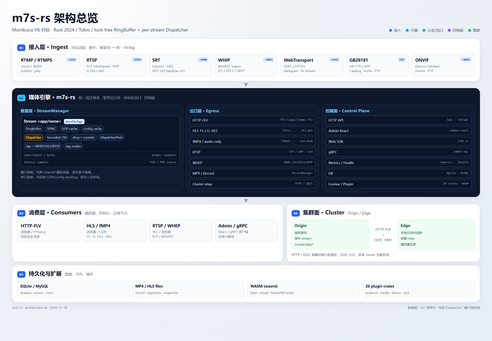
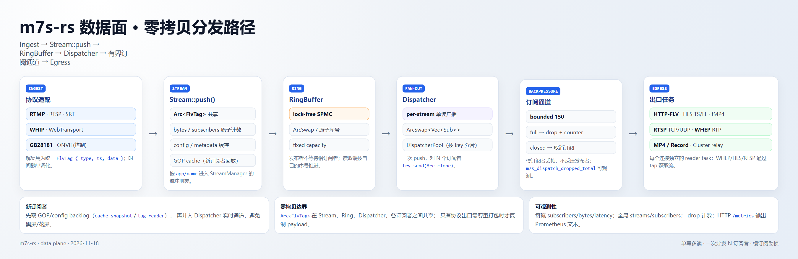

# m7s-rs 架构（Monibuca V6 对标）

> 更新：2026-11-18 · 对应当前 31 个 crate（5 foundation + 26 plugins）
>
> 旧版架构说明已归档为 [`ARCHITECTURE_LEGACY.md`](ARCHITECTURE_LEGACY.md)（内容过期且部分乱码）。

## 1. 总览



图源：[`architecture-overview.html`](architecture-overview.html)；渲染脚本：[`scripts/render_arch.cjs`](../scripts/render_arch.cjs)。

```text
接入层  RTMP / RTSP / SRT / WHIP / WebTransport / GB28181 / ONVIF
   ↓
媒体引擎  StreamManager + RingBuffer + per-stream Dispatcher + GOP/config cache
   ↓
出口层  HTTP-FLV / HLS(TS, LL) / fMP4 / RTSP / WHEP / MP4 / Cluster relay
   ↓
消费层  浏览器 / VLC / FFmpeg / Admin / gRPC / Edge
```

## 2. 数据面（零拷贝分发）



图源：[`architecture-data-plane.html`](architecture-data-plane.html)。

关键路径：

```text
协议适配
  -> Stream::push(Arc<FlvTag>)
  -> RingBuffer（lock-free SPMC）
  -> Dispatcher（per-stream，单读广播）
  -> 每订阅者有界 mpsc（150）
  -> HTTP-FLV / HLS / fMP4 / RTSP / WHEP / MP4 / Cluster
```

机制：

| 机制 | 说明 |
|---|---|
| `Arc<FlvTag>` | 流、Ring、Dispatcher、订阅者共享；出口重打包时才复制 payload |
| GOP/config cache | 新订阅者先回放配置 + 最近 GOP，减少黑屏/花屏 |
| `Dispatcher` | 一次 push 对 N 个订阅者 `try_send`，每流独立 |
| bounded 150 | 慢订阅者满则丢帧，发布者不阻塞；`m7s_dispatch_dropped_total` 可观测 |
| `DispatcherPool` | 按 stream key 分片，`M7S_DISPATCHER_WORKERS` 配置 |
| tap / tag_reader | WHEP/HLS/RTSP 等按需拉流，不占用 Dispatcher 订阅槽 |
| 时间戳单调化 | `Stream::push` 对回退时间戳做修正 |

## 3. 分层与端口

| 层 | 组件 | 入口/说明 |
|---|---|---|
| 接入 | RTMP/RTMPS | `:1935`，chunk/AMF0，publish/play |
| 接入 | RTSP | `:8554`，TCP interleaved + UDP，H.264/AAC |
| 接入 | SRT | `:9000`，Listener + AES-128（sapflow-srt） |
| 接入 | WHIP | `:8082`，WebRTC 上行 RTP → FLV |
| 接入 | WebTransport | `:4443`，QUIC/HTTP3 datagram + bi-stream TS |
| 接入 | GB28181 | SIP/PS/RTP，Catalog/Invite/PTZ/回放 |
| 接入/控制 | ONVIF | `:8083`，Device/Media2/Events/PTZ |
| 出口 | HTTP-FLV | `/flv/{app}/{name}.flv` |
| 出口 | HLS | `/hls/...`，TS、LL-HLS `_HLS_msn`、AES |
| 出口 | fMP4 | `/fmp4/...`，A/V 与 `aud.m3u8` 音频-only |
| 出口 | RTSP | TCP interleaved / UDP RTP |
| 出口 | WHEP | `:8081`，ICE/DTLS/SRTP |
| 出口 | MP4/Record | `RecordManager` |
| 控制 | HTTP API | `/api/*`、`/v6/api/*` |
| 控制 | Admin React | `/admin-react` |
| 控制 | Web SDK | `/sdk.js` |
| 控制 | gRPC | `:50051`，Stream/Room CRUD；可选 TLS + Bearer token |
| 控制 | Metrics/Health | `/metrics`、`/health` |
| 控制 | DB | SQLite 内置；MySQL 可选 |
| 集群 | HTTP/QUIC | HTTP relay + QUIC `:9443` Origin |

## 4. Workspace 与 crate 边界

```text
m7s-rs/                  # 根引擎：StreamManager、Dispatcher、HTTP、RTMP server、
                         # HLS/fMP4、cluster、gRPC、DB、license、WASM 等
crates/
  m7s-sdk/               # Plugin/TagStream/TagReader/StreamApi/ClusterOptions
  m7s-codec/             # FlvTag、TS mux/demux、媒体帧
  m7s-config/            # 统一配置加载
  m7s-pool/              # 对象池
  m7s-task/              # 任务/取消树
  m7s-plugin-*/          # 26 个官方插件 crate
```

26 个插件分组：

| 分组 | crate |
|---|---|
| 协议 | rtmp、rtsp、flv、hls、webrtc、srt、webtransport、gb28181、onvif |
| 媒体 | mp4、snap、sei、mix、transcode、crypto |
| 工具 | debug、logrotate、report、crontab、test、cluster |
| 设备 | homekit、v4l2、alsa |
| 房间 | live、meeting |

> 当前边界仍不完美：部分协议 server（如 RTMP）仍在根 crate；`EngineContext`/IoC 尚未把 HTTP/事件/配置注入完全统一。这是 P1 项。

### EngineContext（2026-11-21）

`m7s-sdk::EngineContext` 现在携带：

```text
node_id / http_base / rtsp_base
streams: Option<Arc<dyn StreamApi>>
```

协议插件可通过：

```text
ctx.stream_api()
ctx.stream(app, name)
ctx.plugin_enabled(name)
ctx.emit(topic, payload)
ctx.meta()
ctx.http()
```

获取引擎服务，不再依赖根 `StreamManager` 具体类型。RTSP/SRT/WebTransport/RTMP/WHEP/WHIP/ONVIF/gRPC/GB28181 已迁移为
`run_with_context(...)` 并在 `main` 中使用；测试：

```text
tests/rtsp_context.rs::rtsp_uses_engine_context ... ok
```

剩余：其余插件统一迁移
与动态 ABI 生命周期仍未全部完成。

## 5. 控制面与持久化

```text
HTTP API /v6 + /api
  ├─ streams / plugins / license / metrics / health
  ├─ HLS/fMP4/FLV 出口
  ├─ admin-react / admin.js / sdk.js
├─ http_flv.rs（HTTP-FLV 热路径）
  ├─ live room create/join/leave/gift/pk/close
  ├─ db streams/rooms
  └─ wasm load/list/unload/reload/enable/frame/av

gRPC :50051
  ├─ StreamService: List/Get/Create/Delete/GetStatus
  ├─ PluginService: ListPlugins
  └─ RoomService: Create/Join/Leave/List/Close

DB
  ├─ SQLite: m7s_streams / m7s_rooms
  └─ MySQL: users（M7S_MYSQL_URL，可选）
```

## 6. 集群

```text
        ┌──────────── Origin ────────────┐
        │ RTMP ingest / stream store     │
        │ /cluster/api/*                 │
        └───────┬──────────────┬─────────┘
        HTTP-FLV│              │QUIC :9443
        ┌───────▼──────────────▼─────────┐
        │ Edge: local miss -> relay      │
        │ 播放器无感；按需回源           │
        └────────────────────────────────┘
```

- HTTP 故障切换已有进程级测试：`tests/cluster_process_failover.rs`。
- QUIC 已有 `@ping` 心跳、双 origin 发现与故障切换：`tests/quic_failover.rs`（kill A 后 viewer 不中断）。
- QUIC 分片/分区分配、多级 cluster 仍为规划项；QUIC 媒体是 stream，不是 datagram。

## 7. 当前能力边界

| 能力 | 状态 |
|---|---|
| WHEP egress RTP | ✅ `tests/whep_media.rs`（webrtc-rs 客户端） |
| WHIP ingest RTP | ✅ `tests/whip_media.rs` |
| WHEP/WHIP 浏览器/FFmpeg 互操作 | ⏳ 待验收 |
| SVC | ❌ 需外部编码器/分层 |
| 100K | ❌ 需多主机；单机上限约 13–16K |
| QUIC 故障切换 | ✅ `tests/quic_failover.rs` |
| QUIC 分片/多级 cluster | ❌ 规划 |
| LL-HLS 完整 PART/PRELOAD | ⏳ 基础已有，完整规范待补 |
| GB28181 完整录像/PTZ | ⏳ 部分 |

完整的 V6 差异与 P0/P1/P2 排期见 [`V6_DIFF_2026-11-18.md`](V6_DIFF_2026-11-18.md)。

## 8. 重新生成图片

```powershell
# 一次性安装渲染器（约 280MB，不提交仓库）
node node_modules/@puppeteer/browsers/lib/cjs/main-cli.js install chrome-headless-shell@stable

# 用 env 指向安装路径；也可修改 scripts/render_arch.cjs 的默认路径
$env:CHROME_HEADLESS_SHELL="$PWD\chrome-headless-shell\win64-158.0.8127.36\chrome-headless-shell-win64\chrome-headless-shell.exe"

node scripts/render_arch.cjs docs/architecture-overview.html docs/architecture-v6-overview.png
node scripts/render_arch.cjs docs/architecture-data-plane.html docs/architecture-v6-data-plane.png
```

依赖：`puppeteer-core`（已在 `node_modules`）+ `chrome-headless-shell`。
