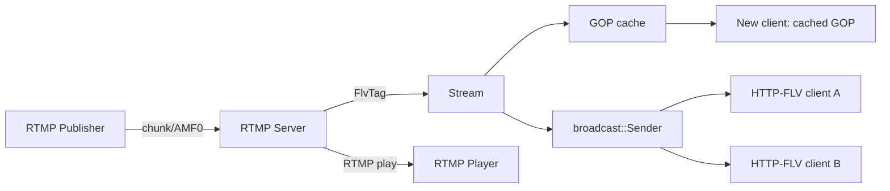
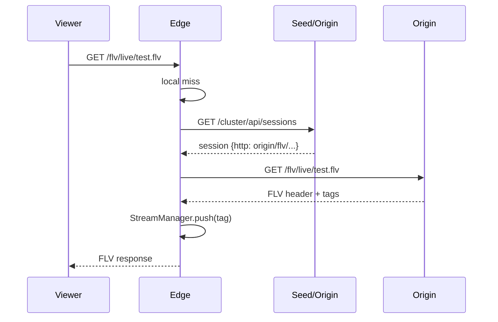

# 架构设计

## 1. 目标

在最小依赖下复现 Monibuca 的核心媒体链路与 Origin/Edge 集群语义：

- RTMP 推流接入
- HTTP-FLV 播放
- StreamManager / GOP 缓存 / 广播分发
- 控制面 `/cluster/api/*`
- Edge 按需回源

不做“假装全协议”：HLS/RTSP/WebRTC/SRT/GB28181 在路线图中明确标记。

## 2. 运行时

### RTMP 接入

- 握手：C0/C1/C2、S0/S1/S2。
- Chunk：fmt 0/1/2/3、basic header、message header、extended timestamp（解析）、chunk size。
- AMF0：connect/createStream/publish/play/onStatus。
- 消息：audio(8)/video(9)/script(18) 转为 `FlvTag`。
- 推流鉴权：`publish_key` 校验 `?key=`。

### Stream

- 每个流一个 `broadcast` 通道 + `VecDeque` GOP 缓存。
- 新订阅者先拿缓存，再进入直播；慢订阅者由 broadcast lag 丢弃，不阻塞发布者。
- `subscribers` 计数用于集群分配/监控。

### HTTP-FLV

- `/flv/{app}/{stream}.flv`
- 输出 FLV header、缓存 tag、直播 tag。
- 本地无流时调用 `Cluster::ensure_relay`。

## 3. 集群

### 角色

- Origin：接收 RTMP 推流，保存流。
- Edge：接收播放；本地无流时回源。
- 节点可同时是 A 流 Origin、B 流 Edge。

### 控制面

| API | 作用 |
|---|---|
| `/cluster/api/status/local` | 节点状态 |
| `/cluster/api/servers` | 节点列表 |
| `/cluster/api/sessions` | 流会话目录（含 `http` 回源地址） |
| `/cluster/api/relay/sessions` | Relay 列表 |
| `/cluster/api/allocate/play` | 播放分配建议 |

### 回源时序

### 与 Monibuca 的差异

| 维度 | Monibuca | m7s-rs |
|---|---|---|
| 传输 | QUIC（quinn） | HTTP-FLV |
| 发现 | 种子 + 心跳 + 全量同步 | 种子查询 |
| 故障 | Healthy/Suspect/Offline | 查询失败即跳过 |
| 分配 | CPU/带宽/订阅者打分 | 返回本节点 |
| 背压 | RingBuffer + bounded channel | broadcast lag 丢帧 |
| 控制面 | `/cluster/api/*` | 同前缀子集 |

## 4. 扩展路线

1. **RTMP 完整性**：扩展时间戳、aggregate、acknowledgement、chunk stream 复用。
2. **HLS**：TS/fMP4 切片、m3u8、低延迟 HLS。
3. **RTSP/GB28181**：RTP/PS 解包、SDP、国标注册/目录/Invite。
4. **WebRTC**：WHIP/WHEP、ICE/DTLS/SRTP。
5. **QUIC Relay**：用 quinn 替换 HTTP-FLV Relay。
6. **无锁 RingBuffer**：`ArcSwap`/原子序号 + 对象池。
7. **插件化**：trait + 动态库/WASM。
8. **运维**：TLS、鉴权、录制、截图、指标、Admin。
